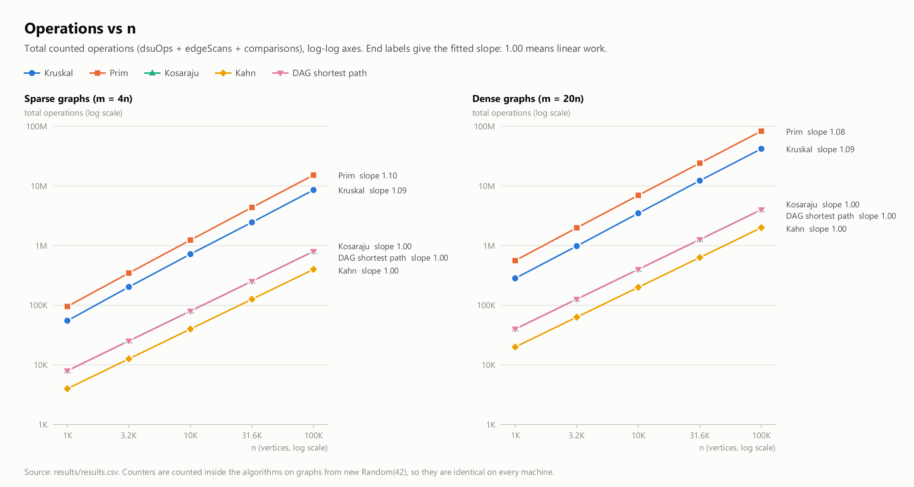
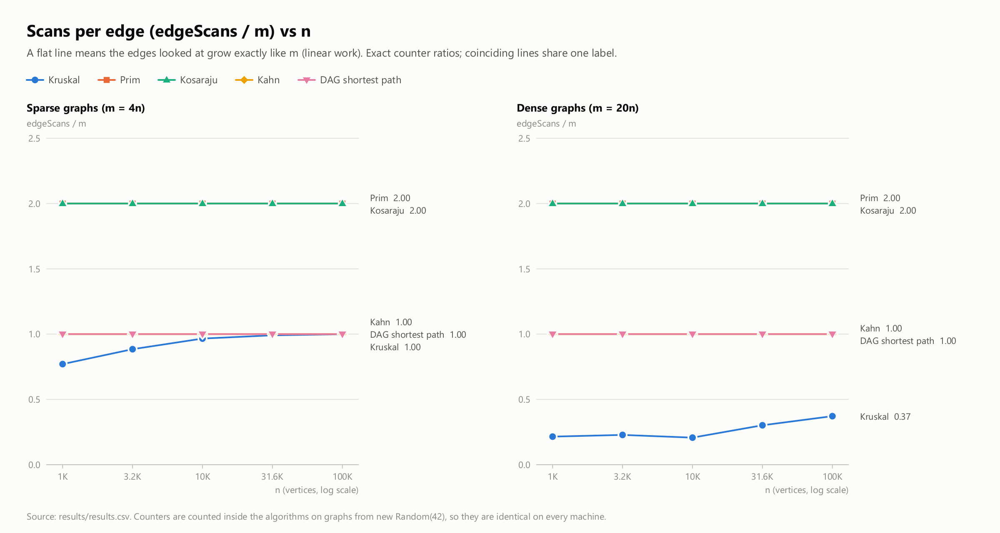
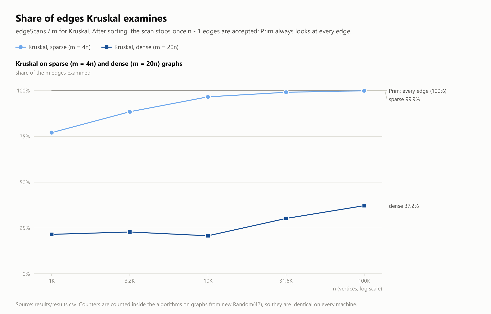

# DAA Assignment 3 — Graphs: City Network & Job Scheduler

**Report.** Every number below comes from `results/results.csv`, `results/bonus.csv` and
`results/analysis.md`, which are all written by one command (`mvn -q compile exec:exec`). The
operation counters are counted inside the algorithms. Because each benchmark graph is built from
its own `new Random(42)`, the counters are identical on every machine. Times come from one
Linux container (4 vCPUs, OpenJDK 21.0.12, bytecode compiled for Java 17, `-Xmx3g`).

**Outcome.** All **30 reference values** of the assignment table (10 MST weights, 10 SCC counts,
10 DAG distance sums) are reproduced exactly. Kruskal and Prim agree on all 10 undirected graphs.
All 10 Kahn orders satisfy `pos[u] < pos[v]`. The exact counter identities hold at every size and
density: Kosaraju **2m**, Kahn **m**, DAG relaxation **m**, Prim **2m** edge scans. The benchmark
checks all of this itself and exits with status 1 if any check fails.

---

## 1. Implementation and counter definitions

One `Graph` class (adjacency lists of immutable `Edge` objects, directed or undirected) serves all
six algorithms. Self-loops, parallel edges and isolated vertices are allowed, and in-degrees are
maintained on insertion (O(1) per edge).

| Counter | Kruskal | Prim | Kosaraju | Kahn | DAG shortest path |
|---|---|---|---|---|---|
| `edge_scans` | sorted edges examined until `n−1` are accepted | adjacency entries examined | adjacency entries examined in pass 1 + pass 2 | outgoing edges examined | edges relaxed |
| `comparisons` | weight comparisons in the hand-written merge sort | weight comparisons made by the `PriorityQueue` | – | – | one `dist[u]+w < dist[v]` test per edge |
| `dsu_ops` | `find` calls + successful `union` calls (counted by the DSU) | – | – | – | – |
| `max_depth` | – | – | largest size of the explicit DFS stack | – | – |

Kruskal uses its own stable merge sort, so the comparison count does not depend on the JDK. It
stops after `n−1` accepted edges. It calls `find(u)`, `find(v)` and then `union`, which performs two
finds of its own, so **`dsuOps = 2·edgeScans + 3·(V−1)` exactly**. Kosaraju's transpose is a
representation step (`Graph.reversed()`) and is not counted. Both of its passes use an `int[]` stack
and a per-vertex next-edge index, so each edge is scanned exactly once per pass. Kahn copies the
in-degrees (O(V)). The DAG row counts only the relaxation pass over Kahn's order, so the
end-to-end cost is `m + m` scans.

## 2. Complexity table

| Algorithm | Time | Extra space | Justification |
|---|---|---|---|
| DSU `find` / `union` | O(α(n)) amortised | O(n) | Union by rank keeps trees at height ≤ log₂n; path compression flattens every path it walks. Together they give the inverse-Ackermann bound. |
| Kruskal | O(E log E) | O(E + V) | The sort dominates; at most 2E finds + 3(V−1) more ops at α(V) each. Space is the sorted copy, the merge buffer and the DSU arrays. |
| Prim (lazy, binary heap) | O(E log E) = O(E log V) | O(E + V) | Each edge enters the heap at most once (when its first endpoint joins the tree), and each push/poll costs O(log E). |
| Kosaraju | O(V + E) | O(V + E) | Two passes, each touching every vertex and adjacency entry once. The transpose costs O(V + E); stack, next-index and finish order cost O(V). |
| Kahn | O(V + E) | O(V) | Every vertex is enqueued and dequeued once; every edge decrements one in-degree once. |
| DAG shortest paths | O(V + E) | O(V) | One relaxation per edge in topological order; `dist`, `parent` and `parentEdge` arrays. |
| Tarjan (bonus) | O(V + E) | O(V) | A single DFS pass with `index[]`, `low[]` and an active-vertex stack; no transpose. |

## 3. Counters vs formulas

Each counter is divided by its formula. A ratio that stays flat as n grows by a factor of 100
is the empirical confirmation of the complexity class.

| Algorithm | Density | Ratio | n=1 000 | 3 162 | 10 000 | 31 623 | 100 000 |
|---|---|---|---:|---:|---:|---:|---:|
| Kosaraju | sparse / dense | edgeScans / (V+E) | 1.600 / 1.905 | 1.600 / 1.905 | 1.600 / 1.905 | 1.600 / 1.905 | 1.600 / 1.905 |
| Kosaraju | both | edgeScans / 2E | 1.000 | 1.000 | 1.000 | 1.000 | 1.000 |
| Kahn | sparse / dense | edgeScans / (V+E) | 0.800 / 0.952 | 0.800 / 0.952 | 0.800 / 0.952 | 0.800 / 0.952 | 0.800 / 0.952 |
| DAG shortest path | sparse / dense | edgeScans / (V+E) | 0.800 / 0.952 | 0.800 / 0.952 | 0.800 / 0.952 | 0.800 / 0.952 | 0.800 / 0.952 |
| Prim | both | edgeScans / 2E | 1.000 | 1.000 | 1.000 | 1.000 | 1.000 |
| Prim | sparse | comparisons / (E log₂V) | 2.196 | 2.186 | 2.180 | 2.178 | 2.167 |
| Prim | dense | comparisons / (E log₂V) | 2.616 | 2.533 | 2.473 | 2.421 | 2.381 |
| Kruskal | sparse | comparisons / (E log₂E) | 0.896 | 0.928 | 0.940 | 0.926 | 0.949 |
| Kruskal | dense | comparisons / (E log₂E) | 0.935 | 0.922 | 0.946 | 0.953 | 0.942 |
| Kruskal | sparse | dsuOps / E | 2.290 | 2.519 | 2.682 | 2.732 | 2.748 |
| Kruskal | dense | dsuOps / E | 0.580 | 0.606 | 0.565 | 0.754 | 0.894 |
| Kruskal (DSU) | sparse | parent links per find | 0.686 | 0.723 | 0.746 | 0.751 | 0.751 |
| Kruskal (DSU) | dense | parent links per find | 0.762 | 0.781 | 0.759 | 0.825 | 0.853 |

* **Traversals (Kosaraju, Kahn, DAG relaxation).** The ratios are constant to the third decimal
  because the counters are exact: 2m, m and m. With m = 4n the formula gives
  2·4n/(n+4n) = 1.600, and with m = 20n it gives 40/21 = 1.905. These are linear O(V + E)
  algorithms with no hidden factor.
* **Prim.** Every adjacency entry is scanned exactly once (2E). The heap comparisons per
  E·log₂V stay between 2.2 and 2.6 and drift slightly *down*: the heap holds fewer than E entries
  and a binary-heap poll costs about 2 comparisons per level. That matches O(E log V) with a
  constant of about 2.
* **Kruskal.** Merge sort makes 0.90–0.95 · E·log₂E comparisons at every size, so the sort is
  O(E log E). `dsuOps / E` is not flat, and the counters explain why: `dsuOps = 2·edgeScans + 3(V−1)`
  holds exactly, so the ratio follows the *share of edges examined*. That share grows with n
  (sparse 0.77 → 0.999, dense 0.21 → 0.37, see plot 3). It is still bounded by a constant
  (2 + 3V/E = 2.75 sparse, 2.15 dense), so the number of DSU operations is O(E). The cost of each
  operation is the α(n) part: the average number of parent links followed per `find` stays
  between **0.69 and 0.85** while n grows 100-fold. That is the "almost constant" behaviour of
  union by rank combined with path compression.

## 4. Slope check (log-log, least squares over the five sizes)

| Algorithm | Density | slope of edgeScans | slope of comparisons | slope of total ops | theory |
|---|---|---:|---:|---:|---|
| Kosaraju | sparse / dense | **1.000** / **1.000** | – | 1.000 / 1.000 | V + E → 1.00 |
| Kahn | sparse / dense | **1.000** / **1.000** | – | 1.000 / 1.000 | V + E → 1.00 |
| DAG shortest path | sparse / dense | **1.000** / **1.000** | 1.000 / 1.000 | 1.000 / 1.000 | V + E → 1.00 |
| Prim | sparse / dense | 1.000 / 1.000 | 1.108 / 1.090 | 1.101 / 1.085 | E log V → 1.11 |
| Kruskal | sparse / dense | 1.055 / 1.119 | **1.105** / **1.087** | 1.093 / 1.088 | E log E → 1.096 / 1.083 |

The traversals give **1.00** exactly. Kruskal is steeper because of the log factor. Its sort
comparisons have slope **1.105 (sparse) / 1.087 (dense)**, against 1.096 / 1.083 for the pure
function E·log₂E over the same sizes. Its total operations have slope 1.093 / 1.088. Kruskal's own
`edgeScans` slope is also above 1 (1.055 / 1.119), but for a different reason. The loop stops at
the heaviest MST edge, and that bottleneck weight grows like log n / degree in a random graph
(the light-edge subgraph must have average degree about ln n to connect everything). So a
growing share of the sorted list is examined.

## 5. Plots

**Operations vs n** (log-log). Kosaraju and the DAG relaxation do exactly 2m operations each,
so their lines coincide. Kahn does m. All three are parallel lines of slope 1.00. Kruskal and
Prim lie one to two decades higher, with slopes of about 1.09–1.10: E log E work.

**Scans per edge** (edgeScans / m). Kosaraju and Prim are flat at exactly 2.00, and Kahn and the
DAG relaxation at exactly 1.00. Flat lines confirm linear work. Kruskal is the only algorithm
below 1: it never needs the edges heavier than the bottleneck MST edge.

**Share of edges Kruskal examines.** On sparse graphs Kruskal examines 77 % → 99.9 % of the
sorted edges, so stopping early saves almost nothing. On dense graphs it examines only
21 % → 37 %, while Prim always scans every edge twice. Kruskal still pays for sorting *all* E
edges up front (≈ 0.94·E log₂E comparisons), and Prim pays 2.2–2.6·E log₂V heap comparisons. In
our counters Kruskal does about half of Prim's comparisons at both densities. Prim wins on dense
graphs already stored as adjacency lists, with an indexed heap or the O(V²) array version.

## 6. Correctness arguments

**Cut property (Kruskal and Prim).** Split the vertices into two non-empty sets S and V∖S, and
let e be a lightest edge crossing this cut. Take any minimum spanning tree T. If T does not
contain e, adding e to T creates a cycle, and that cycle must cross the cut a second time through
some edge f of T. Replacing f by e gives another spanning tree whose weight is not larger, because
w(e) ≤ w(f). So some MST contains e, which means e is *safe*. Kruskal processes edges in
increasing weight. When it accepts e = (u, v) with `find(u) ≠ find(v)`, take S to be u's DSU
component: no lighter edge leaves S (otherwise it would already have merged S), so e is a
lightest crossing edge. Prim uses the cut between the current tree and the rest of the graph, and
always polls the lightest queued edge with exactly one endpoint inside; edges with both endpoints
inside are skipped, so the polled edge is the lightest crossing edge. By induction every accepted
edge keeps the chosen set inside some MST, so both algorithms return a minimum spanning tree.
They return a minimum spanning forest when the graph is disconnected, since the argument works
per component.

**Induction on the topological order (DAG shortest paths).** Let v₁, …, vₙ be the topological
order. Claim: when vₖ is processed, `dist[vₖ]` already equals the true shortest distance δ(vₖ)
from the super-source. Base case: a vertex with in-degree 0 has no incoming edges, so δ = 0, which
is its initial value. Inductive step: take a shortest path to vₖ whose last edge is u → vₖ. Since
every edge goes forward in the order, u = vⱼ with j < k. By the hypothesis, `dist[u] = δ(u)` held
when u was processed. At that point the edge u → vₖ was relaxed, so `dist[vₖ] ≤ δ(u) + w = δ(vₖ)`.
And `dist` never drops below a true path length. Every edge is relaxed once, after its tail is
final, so one pass (O(V + E)) is enough. The benchmark checks the result with an optimality
certificate: no edge can still be relaxed and every vertex has a tight parent edge.

**Why negative weights are safe here but not in general.** The argument above never assumes
w ≥ 0. It only needs every predecessor of v to be final before v is used, and the topological
order guarantees that. In a general graph there is no such order. Dijkstra's greedy rule ("the
closest unsettled vertex is final") breaks, because a later negative edge can still lower an
already settled distance. A negative cycle makes the shortest walk unbounded altogether. That is
why general graphs need Bellman-Ford, at O(VE) with negative-cycle detection. The test
`negativeWeightsAreSafeInADag…` shows a detour of cost 5 − 10 = −5 beating the direct edge of
cost 1.

## 7. Which algorithm when

| Situation | Choice | Why |
|---|---|---|
| MST, sparse graph (E ≈ few·V), or edges given as a list/stream | **Kruskal** | No adjacency needed; the sort over a small E is cheap; DSU makes each cycle test ≈ O(1). |
| MST, dense graph already stored as adjacency lists | **Prim** (heap; O(V²) array version if near-complete) | Grows from the adjacency lists with no global sort; the O(V²) version beats E log E when E ≈ V². |
| MST on a possibly disconnected graph | Either: both return a **forest** + component count | Kruskal handles it naturally; Prim restarts from the next unvisited vertex. |
| Deadlock detection / grouping mutually dependent jobs | **Kosaraju**, or **Tarjan** when memory or time is tight | Both O(V + E). Tarjan needs one pass (m scans instead of 2m) and no transpose. |
| Execution order, cycle possible | **Kahn** | Detects a cycle (fewer than n vertices dequeued) and reports it instead of a wrong order; naturally iterative. |
| Execution order despite cycles | **Condense SCCs, then Kahn** | The condensation is always a DAG. |
| Fastest route through a DAG pipeline, negative weights allowed | **DAG relaxation in topological order** | O(V + E); Dijkstra is wrong with negative edges and Bellman-Ford is O(VE). |
| Shortest paths, general graph, w ≥ 0 / w < 0 possible | **Dijkstra** / **Bellman-Ford** | Without a topological order the one-pass argument does not apply. |
| Critical (longest) path of a schedule | **DAG relaxation with negated weights** | Easy in a DAG, NP-hard in general graphs (bonus B). |
| Any DFS on deep inputs (chains of 10⁵ jobs) | **Iterative DFS with an explicit stack** | A recursive DFS probe overflowed at depth 11 393 on this JVM (default stack size); the explicit stack reached 100 000. |

## 8. A paragraph on time

The measured medians roughly follow the counters: on the dense 100 000-vertex graphs Kahn took
70 ms, Kosaraju 730 ms, Kruskal 1.2 s and Prim 2.3 s. But the times are **not** the evidence. Two
consecutive runs on the same machine gave byte-identical counters and results, while individual
times differed by factors from 0.40 to 1.45. The DAG relaxation on the sparse 100k graph took
46.9 ms in one run and 18.6 ms in the next. On the smallest graphs (≈ 1 ms), JIT compilation and
timer noise dominate: Kosaraju was faster at n = 3 162 than at n = 1 000. The fitted time slopes
range from 0.71 to 1.33, which reflects warm-up, garbage collection and caches more than
complexity. Other hardware, another JVM or background load would change every time and none of
the counters. So the conclusions here rest on `edge_scans`, `comparisons` and `dsu_ops`; the
times are reported only for completeness, as the median of 5 runs.

## 9. Bonus A + B

**Tarjan vs Kosaraju** (`results/bonus.csv`): on all 10 directed graphs Tarjan finds the same
partition (checked vertex by vertex) with **m** edge scans instead of **2m**. The saving comes from
two places. `lowlink` identifies a component root as soon as its DFS subtree finishes, so no second
pass is needed. And no transpose is built, which saves O(V + E) time and memory. On the dense 100k
graph Tarjan took 167 ms against Kosaraju's 730 ms.

**Condensation and critical path.** Each SCC becomes one vertex, and the result is always a DAG,
because a cycle between components would merge them. The longest path is found by negating the
weights and running the same one-pass relaxation. It is 10 134 on the sparse 1 000-vertex DAG and
59 816 on the dense 100k DAG (a chain of 96 jobs). In a DAG the longest path is easy for the same
inductive reason as the shortest path. In a general graph a positive cycle could be walked
forever, and forbidding repeated vertices makes the problem NP-hard (it contains Hamiltonian path).
In scheduling (CPM/PERT) the critical path is the chain of dependent jobs that fixes the earliest
completion time of the project; delaying any job on it delays everything.

## 10. Testing

`mvn clean test` runs 142 JUnit 5 tests, all passing. They cross-check the DSU against a naive
reference, Kruskal against Prim on 100 random connected graphs, SCC against brute-force
reachability, and DAG paths against Bellman-Ford. They also run the 100 000-vertex stack-safety
test and the full reference table. The README lists them.
